<div align="center">

<a href="https://t.me/c0dys"></a>

<a href="https://t.me/c0dys"></a>


</div>

<br/>




<br/><br/>




<br/><br/>




<br/><br/>


<div align="center">

<picture>
  <source media="(prefers-color-scheme: light)" srcset="./profile-3d-contrib/profile-season-animate.svg"/>
  
</picture>


</div>

<!--START_SECTION:waka-->

```go
Total Time: 604 hrs

Go                228 hrs 2 mins        >>>>>>>>>----------------   34.84 %
Python            152 hrs 36 mins       >>>>>>-------------------   23.31 %
Markdown          67 hrs 20 mins        >>>----------------------   10.29 %
Other             50 hrs 34 mins        >>-----------------------   07.73 %
YAML              29 hrs 48 mins        >------------------------   04.55 %
```

<!--END_SECTION:waka-->

<picture>
  <source media="(prefers-color-scheme: dark)" srcset="https://raw.githubusercontent.com/immxrtalbeast/immxrtalbeast/output/pacman-contribution-graph-dark.svg"/>
  <source media="(prefers-color-scheme: light)" srcset="https://raw.githubusercontent.com/immxrtalbeast/immxrtalbeast/output/pacman-contribution-graph.svg"/>
  
</picture>

<br/><br/>

<a href="https://t.me/c0dys"></a>
